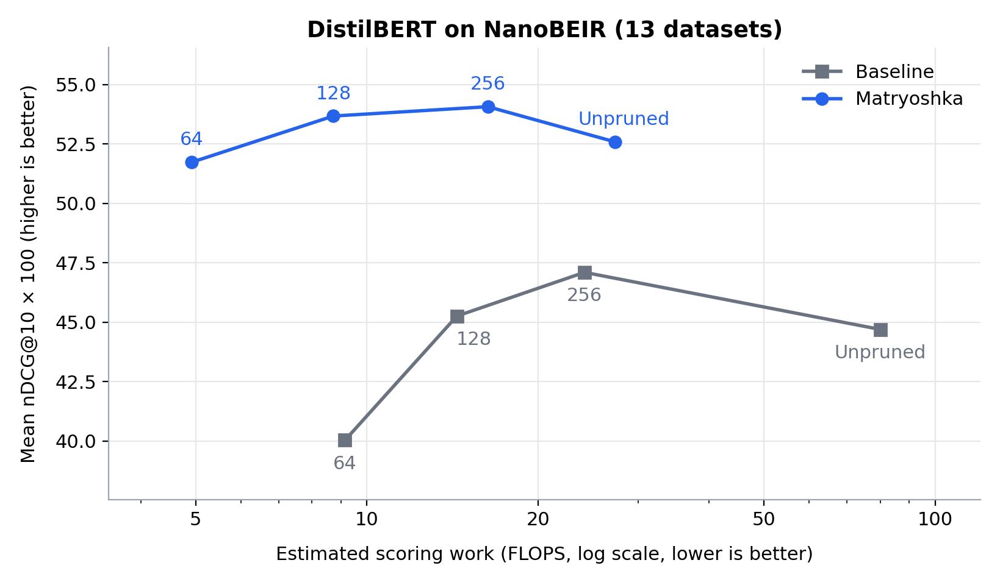

# Sparse Matryoshka Embeddings

Sparse encoders produce vectors with a variable number of nonzero values. Keeping only the largest values with `max_active_dims` can reduce index storage and retrieval work, but pruning may also remove information needed to retrieve relevant documents. <a href="../../../../docs/package_reference/sparse_encoder/losses.html#sparsematryoshkaloss"><code>SparseMatryoshkaLoss</code></a> trains a model at several pruning budgets so that the resulting embeddings can be used at different sparsity levels.

Unlike [dense Matryoshka embeddings](../../../sentence_transformer/training/matryoshka/README.md), sparse Matryoshka training keeps the largest values wherever they occur in the vector. The vector's dimensionality, token IDs, and transformer computation stay the same, and the pruned vectors are not normalized. A budget is an upper bound on the number of nonzero values, so a vector that is already sparse enough is unchanged.

## Training

[train_splade_gooaq.py](train_splade_gooaq.py) trains on [GooAQ with mined hard negatives](https://huggingface.co/datasets/tomaarsen/gooaq-hard-negatives) by wrapping `SparseMultipleNegativesRankingLoss` with `SparseMatryoshkaLoss` inside `CachedSpladeLoss`:

```python
from sentence_transformers import SparseEncoder
from sentence_transformers.sparse_encoder.losses import (
    CachedSpladeLoss,
    SparseMatryoshkaLoss,
    SparseMultipleNegativesRankingLoss,
)

model = SparseEncoder("distilbert/distilbert-base-uncased")
loss = SparseMultipleNegativesRankingLoss(model)
loss = SparseMatryoshkaLoss(model, loss, max_active_dims=[None, 256, 128, 64])
loss = CachedSpladeLoss(
    model,
    loss=loss,
    query_regularizer_weight=5e-5,
    document_regularizer_weight=1e-4,
    mini_batch_size=32,
)
```

The inner loss teaches queries to score their paired answers above the other answers and hard negatives in the batch. `SparseMatryoshkaLoss` computes it on the full embeddings and on copies pruned to at most 256, 128, and 64 active dimensions. By default, it averages these four losses. `CachedSpladeLoss` adds its query and document regularizers once, using the original embeddings. The encoder embeddings are reused across budgets, so each extra budget adds pruning and loss computation, but no extra encoder forward pass.

For different query and document budgets, pass `query_max_active_dims`. Entries are paired by position. For example, `max_active_dims=[None, 256, 128, 64]` with `query_max_active_dims=[None, 64, 32, 16]` trains the pairs `(None, None)`, `(64, 256)`, `(32, 128)`, and `(16, 64)` in query/document order.

The script takes the first 100,000 examples from the `triplet-5` subset, holds out 1,000 for validation, and trains for one epoch. Each example contains a question, its answer, and five hard negatives. Run it with or without `--baseline` to compare the effect of the Matryoshka loss:

```bash
python -m examples.sparse_encoder.training.matryoshka.train_splade_gooaq --baseline
python -m examples.sparse_encoder.training.matryoshka.train_splade_gooaq
```

Both runs use the same initialization, data, regularization, and optimization settings, with `--baseline` removing only the Matryoshka wrapper. The script saves the final model under `models/<run_name>/final` and attempts a Hub upload using your `hf auth login` credentials.

## Evaluation

[evaluate_matryoshka.py](evaluate_matryoshka.py) uses float32 to evaluate a saved model with unpruned embeddings and budgets of 256, 128, and 64 active dimensions on all 13 NanoBEIR datasets. It logs retrieval and sparsity metrics and saves CSV files under `models/<model_name>/eval-matryoshka/`, with a separate folder for each budget:

```bash
python -m examples.sparse_encoder.training.matryoshka.evaluate_matryoshka tomaarsen/splade-distilbert-base-uncased-gooaq-matryoshka
python -m examples.sparse_encoder.training.matryoshka.evaluate_matryoshka tomaarsen/splade-distilbert-base-uncased-gooaq-matryoshka-baseline
```

The following results compare the final checkpoints of the [baseline model](https://huggingface.co/tomaarsen/splade-distilbert-base-uncased-gooaq-matryoshka-baseline) and [Matryoshka model](https://huggingface.co/tomaarsen/splade-distilbert-base-uncased-gooaq-matryoshka) across all 13 NanoBEIR datasets, using BF16 precision and the same active dimension budget for queries and documents. Scores are mean nDCG@10 multiplied by 100.

| Active dimension budget | Baseline nDCG@10 | Matryoshka nDCG@10 | Baseline FLOPS | Matryoshka FLOPS |
|-------------------------|----------------:|------------------:|---------------:|-----------------:|
| Unpruned | 44.69 | **52.59** | 80.09 | 27.35 |
| 256 | 47.10 | **54.07** | 24.15 | 16.33 |
| 128 | 45.26 | **53.68** | 14.40 | 8.73 |
| 64 | 40.03 | **51.74** | 9.15 | 4.92 |



What surprised me most is how much Matryoshka improves retrieval quality even without pruning. In my experiments, it consistently outperforms the baseline across active dimension budgets, making it well worth trying even if you plan to use the full embeddings.

As expected, it also preserves retrieval quality much better as the budget shrinks. Here, the Matryoshka model at 64 active dimensions beats the baseline at every tested budget. It also has much lower FLOPS at the same budgets, so the retrieval gains come with less estimated scoring work.

## Inference

After training, you can load the trained model and choose a budget when encoding queries and documents:

```python
from sentence_transformers import SparseEncoder

model = SparseEncoder("tomaarsen/splade-distilbert-base-uncased-gooaq-matryoshka")
query_embeddings = model.encode_query(["How can I make a retrieval index smaller?"], max_active_dims=64)
document_embeddings = model.encode_document(
    [
        "Pruning sparse embeddings reduces the number of entries stored in an inverted index.",
        "Paris is the capital of France.",
    ],
    max_active_dims=64,
)
query_sparsity = model.sparsity(query_embeddings)
document_sparsity = model.sparsity(document_embeddings)
print(query_sparsity, document_sparsity)
# {'active_dims': 20.0, 'sparsity_ratio': 0.9993447349452854} {'active_dims': 64.0, 'sparsity_ratio': 0.9979031518249132}

scores = model.similarity(query_embeddings, document_embeddings)
print(scores)
# tensor([[18.0077, 10.4297]], device='cuda:0')

decoded_query = model.decode(query_embeddings, top_k=5)
decoded_docs = model.decode(document_embeddings, top_k=5)
print(decoded_query)
# [[(',', 1.997), ('index', 1.920), ('retrieval', 1.864), ('.', 1.775), ('smaller', 1.416)]]
print(decoded_docs)
# [[(',', 2.292), ('index', 2.199), ('pr', 2.176), ('##uni', 2.028), ('sparse', 2.010)],
#  [('paris', 2.513), (',', 2.272), ('france', 2.261), ('capital', 2.186), ('.', 2.023)]]
```

You can also set `max_active_dims=64` when initializing `SparseEncoder` to use that budget by default. An explicit budget in an encode call overrides it, and saving the model preserves the default.
